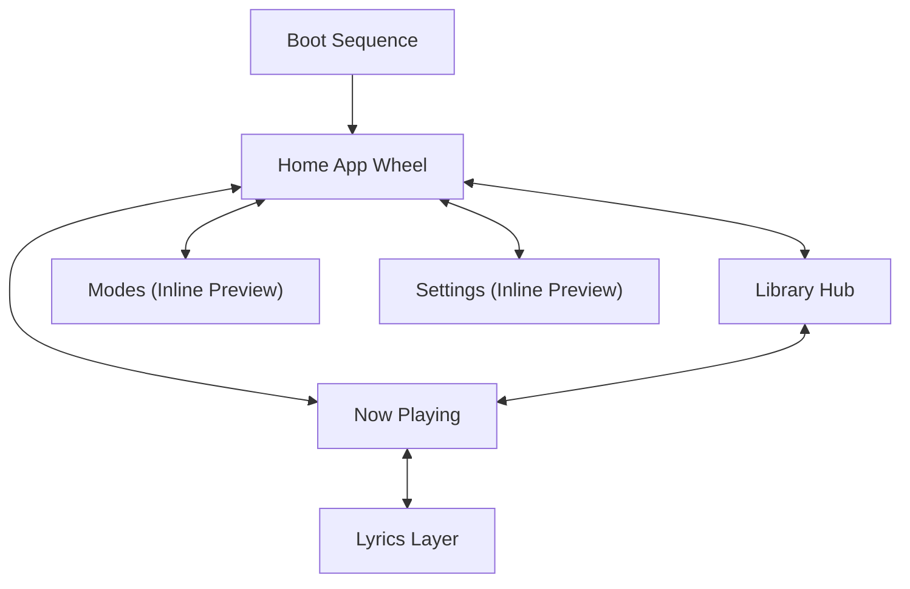

# DialOS — Experience North Star

Read the corresponding section before building any layer to capture every visual token, layout, motion, gesture, menu, filter, and edge state without prescribing implementation mechanics.

### Vertical Build Order
1. **Visual Language, Round Geometry & Shared Primitives** *(Foundation)*
2. **Boot Sequence & System Wake** *(Entry Gate)*
3. **Home Screen & App Wheel** *(OS Shell & Router)*
4. **Playback Engine & Queue Context Rules** *(Core Audio Behavior)*
5. **Now Playing** *(Listening Centerpiece)*
6. **Lyrics** *(Direct Now Playing Layer)*
7. **Library — Hub & Collection Browsing** *(Ordered Simplest → Richest)*
8. **Library — Sorting, Crystal Quick-Seek & Context Actions** *(Power-User Layer)*
9. **Modes & Settings** *(Final App Layer)*

---

## 1. Visual Language, Round Geometry & Shared Primitives

Every screen in DialOS is built on one shared visual, spatial, and interaction grammar crafted specifically for a `360 × 360 px` circular touch display.

### 1.1 Circular Framing & Concentric Safe Zones
The display is a true `360 × 360 px` circle (`180 px` radius), hard-clipped at the circular bezel. All composition, rings, and readable chords align to five concentric spatial zones:
- **Clip Safe Ring (`174 px` radius)**: `6 px` inset margin keeping active chrome clear of the physical circular edge.
- **Outer Tick & Text Chord Ring (`160 px` radius)**: `20 px` inset boundary hosting perimeter ticks, boot sweeps, and maximum horizontal text widths.
- **Orbital Arc Ring (`148 px` radius)**: Dedicated track for rotating progress and warning arcs.
- **Registration Mark Ring (`136 px` radius)**: Anchors intercardinal diagonal `×` marks.
- **Inner Stage Ring (`112 px` radius)**: Central hero area for 3D app cubes, vinyl, seek lenses, and medallions.

### 1.2 Semantic Appearance Modes (Dark Mode & Light Mode)
DialOS supports two first-class appearance modes—**Dark Mode** and **Light Mode**—switching live across every surface, plate, icon, and 3D shader through role-matched tokens:

| Semantic Role | Dark Mode | Light Mode | Where It Appears |
| :--- | :--- | :--- | :--- |
| **Canvas** | `#060709` (deep obsidian) | `#E6E8EB` (cool matte grey) | Full display background; 3D voxel separation strokes |
| **Surface Plate** | `#12151B` (dark charcoal) | `#D6D9DF` (light cool slate) | Elevated cards, chamfered buttons, sheets, badges |
| **Hairline Grid** | `#232833` (muted slate) | `#C0C5CE` (soft silver) | Inactive rim segments, subtle rings, perspective grids |
| **Strong Hairline** | `#485060` (steel grey) | `#828A96` (mid slate) | Structural borders, dividers, brackets, inactive ticks |
| **Primary Ink** | `#F5F6F8` (crisp alabaster) | `#2E3238` (deep charcoal) | Primary titles, labels, main emblem ring, filled segments |
| **Secondary Ink** | `#8D96A6` (cool slate) | `#626A76` (medium graphite) | Subtitles, metadata, major ticks, technical readouts |
| **Signal Highlight** | `#C0FE05` (electric lime) · `#060709` ink · `16%` tint | `#E85A24` (signal orange) · `#FFFFFF` ink · `20%` tint | Active focus, progress arcs, leading waves, corner brackets, back-swipe arc, cursors, toasts |
| **Signal Alert** | `#FF2E17` (vivid red-orange) · `22%` tint | `#CC3124` (deep crimson) · `16%` tint | Fault banners, hazard stripes, high-output volume warning, destructive hold-to-delete arc & flash |
| **3D Highlight Faces** | Top `#DAFF66` · Right `#C0FE05` · Left `#8BB803` | Top `#F27B4C` · Right `#E85A24` · Left `#B84316` | Directional flat shading on active leading 3D surfaces |
| **3D Structural Faces** | Top `#FFFFFF` · Right `#D6DCE6` · Left `#8E97A6` | Top `#4E545E` · Right `#343940` · Left `#22252B` | Directional flat shading on settled 3D surfaces |
| **3D Wireframe** | Cool grey-blue at `34%` opacity | Cool slate at `38%` opacity | Unfilled 3D lattice outlines awaiting activation |

### 1.3 Typography & Formatting
- **Display Geometric Sans**: Heavy and extra-bold weights for focal heroes—screen titles, active lyric lines, the `"DIAL"` wordmark, and oversized numeric readouts (volume percentage, seek clock, delay timer).
- **Technical Monospace**: Semi-bold to extra-bold uppercase for telemetry, status chords, badges (`"OS"`), metadata subtitles, row counts, and button captions.
- **Standardized Formatting**: Library counts use comma grouping (e.g., `1,240`, clamped non-negative); playback clocks use zero-padded `MM:SS` (`00:00` fallback); fault timers show live tenths of a second (`0.0s`).

### 1.4 Geometric Craft & Shared Visual Primitives
- **Pure Geometric Precision**: Flat solid fills, crisp hairlines, and translucent optical-glass surfaces with zero soft drop shadows or blurred gradients on structural controls.
- **Two Plate Styles**:
  - *45° Chamfered Octagonal Plates*: Used on interactive buttons, list rows, cards, action sheets, and toast pills.
  - *Sharp 0 px Industrial Plates*: Used on compact status badges, blinking terminal block cursors, alert banners, and progress bars.
- **Optical Glass & Corner Brackets**: Translucent crystal containers pair subtle diagonal glass glare streaks with opposing top-left and bottom-right L-shaped **Signal Highlight** registration brackets whenever focused or pressed.
- **Perspective Floor Grids**: Architectural wireframe planes establish spatial depth and motion parallax:
  - *Home Floor*: Mid-lower 4-line trapezoidal grid whose vertical rails scroll continuously with the wheel, topped by an elliptical caustic reflection beneath the hero cube and faint upper-left neutral / lower-right Signal Highlight rim sheen arcs.
  - *Library & Now Playing Floor*: Deeper 3-line, 7-rail plane drifting gently with list scroll or ambient motion, framed by opposing upper-left and lower-right diagonal `×` marks.
- **Registration Marks & Perimeter Ticks**:
  - *Orthogonal `+` Crosshairs*: Anchor structural horizontal dividers and peripheral Lyrics markers.
  - *45° Diagonal `×` Marks*: Punctuate intercardinal corners; shift from muted hairline/secondary ink to bold Signal Highlight when progress passes their quadrant.
  - *48-Tick Perimeter Ring*: Sweeps clockwise from 12 o'clock with longest bold cardinal ticks (every 12th), medium half-quadrant ticks (every 6th), and fine hairline ticks between.
- **DialOS Disc-Dial Emblem**: Bold Primary Ink outer ring broken by an upper-right notch (~1:30–2:30), fine concentric inner ring (`56%` radius), solid center spindle dot (`22%` radius), and a diamond-rotated Signal Highlight square detent nestled inside the gap (popping in from `40%` to `100%`).
- **Hazard Stripe Band**: Clipped rectangular band of 45° Signal Alert stripes scrolling continuously rightward during active fault states.

### 1.5 Motion Character & Pacing
Movement is mechanical, immediate, and free of bouncy overshoot:
- **Fast exponential snap** for element pops, scale-ins, and detent entries.
- **Smooth cubic ease-out** for fades, sweeps, and status reveals.
- **Symmetric cubic ease-in-out** for shutter wipes, collapses, and full-screen transitions.
- **Critically damped spring settling** for wheels, carousels, and lists—incorporating flick velocity so single gestures advance cleanly without wobble.

### 1.6 Shared Interactive Patterns & Input Grammar
- **Marquee Text**: Labels that fit remain static. Overflowing text clips cleanly to its slot and runs a continuous loop: `0.9 s` start pause → smooth `28 px/s` leftward glide → `0.8 s` end pause → `36 px` whitespace gap → seamless wrap.
- **Universal Left-Edge Back Swipe**: DialOS uses zero on-screen back arrows. Dragging rightward from the left edge grows a thick (`4 px`), flat-capped Signal Highlight arc symmetrically around 9 o'clock along the bezel (`168 px` radius) over a `96 px` pull. Releasing at `≥45%` commits one step back (or closes the topmost overlay); releasing earlier smoothly retracts the arc.
- **Transient Feedback Toasts**: Compact chamfered dark translucent pills (`90–92%` opacity) with a Signal Highlight border—used for sort mode confirmations (centered mid-upper chord, `1.35 s` hold + fade) and playback/boundary notices (gliding gently downward into the upper chord, `1.6 s` hold + fade, auto-marqueeing when wide).
- **Direct-Touch, Hold & Rim Grammar**:
  - *Direct Tap*: Immediate action with minor drift forgiveness (`≤10 px`; `≤14 px` on boot retry). Resting tiles and rows never pre-highlight—they illuminate only while actively pressed.
  - *Deliberate Long-Press*: Opens secondary controls without cluttering resting screens—`0.36 s` for the Radial Sort Wheel, `0.42 s` for Now Playing Seek Mode, and `0.48 s` for Library Quick Actions / Playlist management. Destructive deletion requires a sustained `1.10 s` hold paired with a full 360° bezel countdown arc.
  - *Bezel Rim-Arc & Rotary Input*: Tracing around the circular perimeter scrolls lists (clockwise down, counter-clockwise up, escalating to Crystal Quick-Seek after `180°`) and adjusts volume along Now Playing's right bezel. Discrete rotary detents step one item per notch on Home and Library (`130 ms` cadence) and adjust continuously inside Now Playing.

---

## 2. Boot Sequence & System Wake

The boot sequence is a self-contained four-act startup choreography (`4.50 s` minimum nominal duration) that brings the display alive, tracks live library indexing, and hands seamlessly into Home.

### 2.1 Core Four-Act Happy Path
1. **Act 01 — Wake Matrix (`0.00 s → 0.95 s`)**
   - *Laser Wake Slit (`0%–18%`)*: A `2 px` horizontal Signal Highlight line flashes outward from center (`16 px → 292 px` wide) and fades out.
   - *Perimeter Ticks & Corner Marks*: 48 radial ticks sweep clockwise around the `160 px` ring (`8%–72%`), while four intercardinal diagonal `×` marks pop in sequentially around the `136 px` ring (`10%–40%`), flashing Signal Highlight before settling to Secondary Ink.
   - *5×5 Wake Matrix*: Centered slightly above midline (`Y=174`) inside four hairline corner brackets (`12%–30%`), 25 outlined cells sweep diagonally top-left to bottom-right (`16%–60%`). Each cell flashes Signal Highlight before settling into a pixelated disc silhouette (Primary Ink outer ring, two bright Signal Highlight diagonal inner cells, faint center dots on inactive cells), then scales down to `26%` and fades out (`80%–100%`).
   - *Status Caption (`Y=286`)*: `"MEM // CHECK"` in Secondary Ink monospace paired with a fast-blinking (`~9 Hz`) Signal Highlight block cursor.
2. **Act 02 — Buffer Sweep & Live Scan (`min 1.95 s`, holds until ready)**
   - *48-Segment Sweep Rim (`157 px` radius)*: Sweeps clockwise from 12 o'clock. Unfilled segments are `2.5 px` hairlines; filled segments alternate Signal Highlight and Primary Ink (`6.5 px` wide) with a bolder `9 px` leading segment.
   - *Quadrant Illumination*: The four corner `×` marks flip from muted hairline to crisp Signal Highlight as sweep progress crosses `15%` (TR), `40%` (BR), `65%` (BL), and `85%` (TL).
   - *Tumbling 3×3×3 Voxel Cube (`Y=164`)*: Scales in (`58% → 100%`, `0%–14%`) while tumbling smoothly (steady yaw, gentle oscillating pitch, slight roll). Its 27 sub-cubes fill diagonally corner-to-corner: unreached cells stay delicate wireframes, activated sub-cubes pop `45% → 100%`, the active leading diagonal wave (and last three sub-cubes) illuminates in 3-tone **Signal Highlight**, and settled sub-cubes become 3-tone **Primary Ink** solids.
   - *Pacing Safeguard*: While indexing is still running, sweep progress advances smoothly up to a `92%` visual hold cap so it never finishes prematurely. Once ready, it completes the `1.95 s` minimum or catches up cleanly (`150%/s`). The exit fade (`92% → 99.5%`, cube contracting `100% → 86%`) waits until both time and scan completion agree.
   - *Live Readout (`Y=286`, Primary Ink + `3 Hz` blinking cursor)*: Progresses through `"INIT // SIMULATOR"` → `"SCAN // DISCOVERING"` → `"SCAN // <scanned> / <discovered>"` → `"INDEX // <albums> ALBUMS"`, and across sweep bands once ready: `"SCAN // <tracks> TRACKS"` → `"INDEX // <albums> ALBUMS"` → `"LOCK // SYSTEM READY"`.
3. **Act 03 — Signal Lock (`1.05 s`)**
   - *Shutter Wipe (`0%–32%`)*: A `56 px`-tall solid Signal Highlight bar sweeps left-to-right across the center (`280 px` span) to unveil the brand lockup.
   - *Lock Rim*: Thin `160 px` hairline circle accented by a bold Primary Ink upper-left arc, bold Signal Highlight lower-right arc, and two opposing diagonal `×` marks.
   - *Emblem & Wordmark*: The DialOS Disc-Dial emblem fades in at `Y=124` (`31 px` radius) with its Signal Highlight detent popping in (`24%–56%`). Centered at `Y=196` sits extra-bold `"DIAL"` beside a sharp Signal Highlight rectangle carrying inverse monospace `"OS"`.
   - *Divider & Welcome Chord*: A hairline divider (`Y=228`) expands from center to `148 px` wide, sprouting tiny `+` crosshairs at both ends past `40%`. Beneath it sit a Signal Highlight square dot + `"WELCOME"` (`Y=252`) and the live library summary line (`Y=276`).
4. **Act 04 — Home Handoff (`0.55 s`)**
   - The lock rim expands off-bezel (`160 px → 198 px`) while fading out; wordmark, divider, crosshairs, `"WELCOME"`, and summary drift downward `18 px` and fade away over the first `55%`.
   - The DialOS emblem glides from `Y=124` to dead center (`Y=180`) while growing (`31 px → 38 px` radius). Between `15%` and `100%`, a `2 px` Signal Highlight halo expands around the centered emblem (`42 px → 62 px`) and fades out, transferring seamlessly to Home on the final frame.

### 2.2 Non-Blocking Empty & Missing Library States
An empty or absent music collection never stalls or errors Boot. Signal Lock surfaces the exact state on its summary line before handing off normally to Home:
- **Populated library**: `"V1.0 · LIB OK · <N> TRACKS"`
- **Empty library (folder exists, 0 tracks)**: `"V1.0 · EMPTY LIB · 0 TRACKS"`
- **Missing music folder**: `"V1.0 · NO FOLDER · 0 TRACKS"`

### 2.3 Engine Delay & Fault Warning Recovery
Triggered if readiness stalls for `8.0 s` across Wake + Buffer, or upon any explicit backend/bus fault:
- **Visuals**: Clockwise-orbiting 24-segment alert ring (`148 px` radius, four bold `5 px` Signal Alert cardinal arcs + thin spacers), scrolling diagonal Signal Alert hazard stripe band (`Y=72`), sharp `0 px` Signal Alert banner `"AUDIO ENGINE SLOW"` (`Y=118`), live extra-bold tenths timer (`0.0s`, `Y=192`), smoothly breathing Signal Highlight square LED (`35%–100%` opacity) beside `"POLLING LOCAL BUS"` (`Y=233`, surfacing `ERR // <ERROR>` on explicit faults), and a chamfered `"TAP TO RETRY"` plate (`Y=262` with generous touch area).
- **Recovery**: Background polling auto-recovers into the interrupted act as soon as readiness returns or the error clears. Tapping `"TAP TO RETRY"` immediately clears fault state, resets the stall timer, and returns to Act 02 Buffer Sweep.

---

## 3. Home Screen & App Wheel

Home is the central launcher and state hub of DialOS, presenting four apps as floating 3D translucent optical-glass cubes around an infinite cyclic wheel.

### 3.1 Spatial Glass Stage
- **Bezel Sheen**: Subtle cool specular arc at upper-left and faint Signal Highlight arc at lower-right—intentionally zero clock or compass ticks.
- **Scrolling Perspective Floor**: Mid-lower 4-row trapezoidal wireframe grid whose vertical rails scroll seamlessly in lockstep with the wheel.
- **Floating Caustic Reflection**: Soft dual-ring elliptical reflection beneath the focused cube that expands and contracts subtly in inverse rhythm with the hero's vertical float.
- **Top Handle & Status Beacon**: Centered horizontal grip bar at the top edge above a compact status line pairing a square indicator dot (muted when idle; Signal Highlight when playing, paused, or in USB Storage) with live telemetry: `PLAY · VOL <NN> · 94%`, `PAUSE · VOL <NN> · 94%`, `IDLE · VOL <NN> · 94%`, or `USB MODE · BAT 94%`.

### 3.2 Infinite 4-App 3D Optical-Glass Cube Wheel
Every app lives inside a four-layer 3D optical-glass cube: tinted rear chamber walls, an inset inner wireframe for glass depth, a living 3D sculptural icon suspended inside, and translucent front facets with two angle-reactive diagonal glare streaks and crisp edges. The focused cube lights up with opposing **Signal Highlight** L-shaped corner brackets and active interior colors; unfocused neighbors dim their interiors to muted greys.

| Order | App | Interior 3D Sculpture | Dynamic Subtitle (Uppercase Monospace, Auto-Marquee) |
| :-: | :--- | :--- | :--- |
| **1** | **Now Playing** *(Live)* | **Playing / Paused**: Foreshortened 3D circular vinyl album-art disc (real cover or geometric fallback, zero grooves/label) above a 4-bar alternating equalizer (animated waves when playing; flat low bars when paused; hidden on distant small cubes). **Idle**: Turning open turntable arc, inner groove ring, center hub, and swaying tonearm with pulsing accent stylus. **USB Storage**: Hovering 3D drive body with accent top connector and two upward-sweeping transfer bars. | Playing/Paused: `<TRACK TITLE> · MM:SS / MM:SS` Idle: `NOT PLAYING · BROWSE LIBRARY` Storage: `USB STORAGE · 42.6 GB FREE` |
| **2** | **Library** *(Live)* | Vertical spindle holding three tilted, levitating, counter-rotating 3D discs—dark upper/lower discs with accent notches flanking a larger accent-filled center hero disc. | Populated: `<N> TRACKS · <M> ALBUMS` Empty: `EMPTY LIBRARY · 0 TRACKS` |
| **3** | **Modes** *(Inline Preview)* | 3D routing bus grid connecting four corner blocks; an accent signal pulse travels around the circuit while each corner block takes turns popping forward and lighting up. | `STORAGE · DAC · WIRELESS` |
| **4** | **Settings** *(Inline Preview)* | Three horizontal mixer rails with solid 3D fader caps gliding at independent rhythms (center cap highlighted). | `<DARK MODE \| LIGHT MODE> · VOL LIMIT 85%` |

- **Infinite Wrapping & Perspective Depth**: Wraps seamlessly across Settings ↔ Now Playing in both directions. Five slots render back-to-front so the hero always sits foremost: hero (`90 px` across, slightly above center, gently bobbing and swaying in 3D), immediate neighbors (`50 px`, stepped outward and slightly down along a shallow arc, angled outward), and distant slots (`32 px`, fading smoothly to invisible between `1.05` and `1.62` slots off-center before touching the rim).
- **Bottom Metadata Chord**: Bold app title, uppercase marquee subtitle, and 4 horizontal page bars. While dragging between slots, title and subtitle slide gently opposite the drag and crossfade near the midpoint. The 4 page bars morph continuously—the focused bar widens from `6 px` to `20 px` and illuminates in Signal Highlight smoothly across detents and across the wrap seam.

### 3.3 Gestures, Detents & Playback Telemetry
- **Horizontal Drag & Flick**: Tracks 1:1 (`112 px` per detent). Release engages a critically damped spring snap (no overshoot) with velocity projection up to `~0.45` slots for effortless single-flick advances.
- **Tap & Rotary**: Tapping the focused hero launches the app; tapping a left or right neighbor centers it without launching; tapping open space settles to the nearest detent. Rotary input steps one slot per notch (`130 ms` cooldown).
- **Live Playback on Home**: Playing tracks spin the Now Playing cube's vinyl continuously clockwise (`~32.3°/s`), animate its 4-bar equalizer, light the top beacon (`PLAY`), and tick `elapsed / duration`. Pausing freezes the exact vinyl angle and flattens the equalizer (`PAUSE`). The outer-edge progress ring stays hidden at rest on Home, and no volume gesture operates on Home.

### 3.4 Launch & Return Transitions
- **Boot → Home (`0.78 s`)**: The centered Boot emblem cross-dissolves into the Now Playing hero cube as it rises from dead center, expands to hero size, and completes a quarter-turn settle spin while side cubes glide inward and stage chrome + bottom chord rise into place.
- **Unified `0.62 s` Stage Choreography**: On every launch, neighboring cubes part rapidly outward off the rim over the first `52%`, while stage chrome and bottom metadata fade out over `42%–45%` (bottom text drifting gently downward). Returns reverse cleanly while re-anchoring Home on the returning app.
- **Home ↔ Now Playing**:
  - *Active track (direct vinyl zoom)*: Over `0.62 s`, the cube expands and flattens while its glass shell and equalizer dissolve (`0%–36%`). The vinyl glides to dead center and zooms edge-to-edge (`360 px`), spinning **+20° clockwise** at matched speed when playing (or holding exact frozen angle when paused) and handing that exact angle straight to Now Playing so there is zero jump. The thin outer-edge progress ring fades in across `72%–100%`. Returning runs the exact reverse with angle continuity.
  - *Idle (no active track)*: Launches immediately to the dedicated Now Playing idle screen. Returning glides the cube smoothly down from an upper-center resting medallion (`60 px → 90 px`) while `"Not Playing"` text fades out.
- **Home ↔ Library (Acrylic Cube Dive)**: Over the first `56%`, the Library cube glides to center, flattens straight-on, and expands dramatically (`~356 px`) while its 3-disc sculpture (`8%–36%`) and glass shell (`14%–54%`) dissolve as you dive through it. Behind it, the live Library Hub emerges in depth layers: floor (`24%–68%`), top tiles scaling `80% → 100%` (`30%–88%`), peeking tiles & header (`42%–100%`), and scroll arc (`65%–100%`). Returning captures the exact **Library Hub scroll position** and vinyl angle, receding the Hub at that scrolled offset as the cube re-forms (re-launching Library resets scroll to top).
- **Home ↔ Modes & Settings (Inline Preview Overlays)**: The focused cube shrinks (`90 px → 50 px`) and floats near the top as a living 3D header medallion while the title, three stacked monospace rows (top accented, lower two muted), and `"SWIPE FROM LEFT EDGE"` glide up (`36%–95%`). Committing a left-edge swipe (`≥45%`) reverses smoothly back to the wheel.

---

## 4. Playback Engine & Queue Context Rules

Playback and queue rules are shared across every screen so launching, skipping, shuffling, repeating, or editing favorites/playlists behaves identically everywhere.

### 4.1 Continuity & Cross-Screen Synchronization
- Audio playback, elapsed time, volume, and cumulative vinyl rotation continue uninterrupted across Home, Library, and Now Playing.
- Re-selecting the currently loaded track preserves elapsed playback time (resuming if paused) while applying any newly chosen queue context or shuffle order.

### 4.2 The Six Strictly Isolated Contexts
Playback never bleeds from one context into another (finishing or skipping past an album never jumps into another album):

| Context | Badge | Queue Composition & Natural Order |
| :--- | :--- | :--- |
| **Album** | `ALBUM` | Selected album's tracks in disc/track order |
| **Artist** | `ARTIST` | Deduplicated tracks across the artist's albums, sorted `A–Z` by title |
| **Genre** | `GENRE` | All tracks matching the genre tag (multi-genre aware), sorted `A–Z` by title |
| **Playlist** | `PLAYLIST` | Tracks in the playlist's exact curated sequence |
| **Favorites** | `FAVORITES` | All favorited tracks, sorted `A–Z` by title |
| **All Songs** | `ALL SONGS` | Full library catalog in canonical order |

### 4.3 Sequential Skips, 3-Second Rule & Context Boundaries
- **3-Second Previous Rule**: Triggering Previous when elapsed time is **strictly greater than `3.0 s`** restarts the current track at `0:00` (subtle rotational nudge, no cover slide, no track banner). At `≤3.0 s`, it steps to the previous track.
- **Boundary Bounce & Toasts**: Attempting to skip past the first or last track when wrapping is off keeps playback running, gives a subtle reverse rotational bounce, and shows a top toast: **`START OF <CONTEXT>`** or **`END OF <CONTEXT>`** (e.g., `END OF ALBUM`, `START OF PLAYLIST`, `END OF ARTIST`).

### 4.4 Shuffle & Repeat Matrix
- **Shuffle ON / OFF**: Builds an unbiased shuffled deck strictly within the active context's unique tracks.
  - *Toggling Shuffle ON mid-playback* anchors the active track at slot 0 (`01 / N`) without audio interruption and shuffles remaining tracks behind it.
  - *Toggling Shuffle OFF* restores natural context order aligned cleanly to the playing track.
  - *Launching with Shuffle ON* anchors the selected track at slot 0 and shuffles the rest.
  - *Previous skips* walk cleanly backward through the active shuffle order.
  - *Repeat All + Shuffle wrap* deals a fresh shuffled deck guaranteeing the just-finished track does not repeat at slot 0 (when `≥2` tracks exist).

| Repeat Mode | Manual Next at End | Manual Prev at Start (`≤3 s`) | Manual Prev (`>3 s`) | Auto-End at Last Track |
| :--- | :--- | :--- | :--- | :--- |
| **Off** | Boundary bounce + `END OF <CONTEXT>` | Boundary bounce + `START OF <CONTEXT>` | Restart at `0:00` | Resets to slot 0 at `0:00` **paused** + `END OF <CONTEXT>` |
| **All** | Wraps to slot 0 (reshuffles if Shuffle ON; restarts if 1 track), keeping play/pause state | Wraps to last slot (or restarts if 1 track), keeping play/pause state | Restart at `0:00` | Wraps seamlessly to slot 0 playing (reshuffles if Shuffle ON) |
| **One** | Same as **Off** (never traps manual skip) | Same as **Off** (never traps manual skip) | Restart at `0:00` | Loops current track from `0:00` playing (unless ephemeral) |

### 4.5 Live Favorite & Playlist Mutations During Playback
- **Unfavoriting inside `FAVORITES` / Removing a track inside `PLAYLIST`**: Non-playing tracks drop live from the queue without shifting the active track. Removing the *currently playing* track marks it **ephemeral**—it finishes playing uninterrupted, then drops on natural end (even under Repeat One), manual skip, or queue selection; if the context becomes empty, playback stops cleanly to Idle with toast **`NO TRACKS LEFT`**. Re-favoriting restores it live.
- **Adding tracks**: New favorites or playlist additions merge live (into sorted order when Shuffle is OFF, or appended to the deck tail when Shuffle is ON without reshuffling retained tracks).
- **Deleting the active playlist**: Stops playback immediately to Idle with toast **`PLAYLIST DELETED`**.
- **Outside `FAVORITES` / `PLAYLIST`**: Favorite toggles sync immediately across all UI metadata without disturbing the active queue.

---

## 5. Now Playing

Now Playing is the listening centerpiece: edge-to-edge spinning album art with zero resting clutter and tactile gestures layered quietly on top.

### 5.1 Idle State & Entrance Transitions
- **Not Playing (Idle)**: Drifting perspective wireframe floor, upper/lower rim sheen arcs, two diagonal `×` marks, gently breathing circular medallion with rotating accent arc and turntable/tonearm emblem, bold **"Not Playing"**, monospace **`NO TRACK QUEUED ON DISC`**, and a solid-accent chamfered **`BROWSE LIBRARY`** CTA button with corner brackets.
- **From Home / Library (`0.62 s`)**: Centered compact vinyl (`~108 px`) expands smoothly to full-bleed (`360 px`) while inheriting live vinyl rotation angle (skipped when Home already ran the direct vinyl zoom); outer-edge progress ring fades in across the second half.
- **From Albums Crate (`0.62 s`)**: Two-stage "slip out of sleeve" choreography—the square album sleeve slides leftward off-screen while fading out, while the vinyl slips rightward from behind the sleeve to a brief apex and glides to display center as it expands to full-bleed.

### 5.2 Full-Bleed Optical Vinyl Resting View
- **Spinning Artwork**: Circular album art (or geometric motif fallback) fills the entire `360 × 360 px` round face with zero grooves, zero paper label, and zero resting center spindle chrome. Spins clockwise (`~32.3°/s`), coasts smoothly to rest with rotational inertia on pause or Seek Mode, and responds with subtle spring nudges on resume, skips, and queue picks.
- **Outer-Edge Progress Ring**: Crisp, thin circular track hugging the very perimeter—a faint full-circle rail with a Signal Highlight arc sweeping clockwise from 12 o'clock.
- **Double-Tap Play / Pause**: Toggling playback flashes a centered dark circular pulse medallion with accent outline and accent Play triangle or Pause bars that scales slightly down and fades out (`~0.4 s`).

### 5.3 Horizontal Track Skip, Honest Drag-Peek & Track Skip Banner
- **Swipe / Drag to Skip**: Dragging left skips Next; dragging right skips Previous (commits at `≥56 px`, else springs back).
- **Honest Cross-Album Cover Drag-Peek**: Evaluates the exact skip rule live during the drag. Only when skipping will jump to a *different album cover* does the current disc slide horizontally with the finger while the incoming album disc peeks in from the edge with subtle rotational twist (committing plays a `0.42 s` dual-disc slide with outgoing dim/back-spin and incoming forward momentum, suppressing the top banner). Same-album skips, 3-second restarts, reshuffle-wraps, and blocked boundaries keep the disc centered with rotational twist feedback (stiffened resistance at blocked edges).
- **Same-Album Track Skip Banner**: Appears near the top on same-album skips only (suppressed on cross-album slides, context end, Lyrics, or any open overlay/sheet; dismisses active toasts). Dark chamfered card with a centered accent top bar (`0.24 s` fade-in with slight drop, `2.0 s` hold, `0.42 s` fade-out) showing marquee track title over a context-aware metadata line:
  - *Album*: `01 / 12 · 3:45`
  - *Artist*: `ALBUM TITLE · 3:45`
  - *All other contexts*: `ARTIST · 3:45`

### 5.4 Right-Bezel Volume Control & Dual Volume HUD
- **Touch Zone**: Right outer rim (`≥135 px` radius, within `±45°` of 3 o'clock; engages after `~8 px`). Dragging counter-clockwise (upward) raises volume; clockwise (downward) lowers it (`180°` sweep = `0%–100%`; rotary wheel steps `±4%`).
- **Dual HUD**: Pairs (1) a curved right-bezel track with dark halo, `85%` limit tick mark, and moving square cap with (2) a centered dark circular medallion featuring a full progress ring, speaker icon (Signal Alert when muted at `0%`, adding a soundwave arc above `0%`), oversized percentage (`62%`), and **`VOLUME`** caption. Above `85%`, the ring, arc, wave, and caption switch to **Signal Alert** and read **`HIGH OUTPUT`**.
- **Fade**: Holds `1.45 s` after release, then fades smoothly; suppresses center spindle and dims Lyrics while visible.

### 5.5 Press-and-Hold Center Seek Mode
- **Hold-Charge (`0.10 s → 0.42 s`)**: Pressing steadily (`<12 px` drift) inside the inner `90 px` center radius charges a clockwise Signal Highlight ring around an emerging center disc (briefly showing a playing dot or paused bars). Releasing before `0.42 s` aborts cleanly.
- **Expanded Seek Dial**: At `0.42 s`, vinyl stops spinning and the center disc expands smoothly to a `62 px`-radius dark dial with soft accent halo, 24 perimeter ticks (longer cardinal ticks at 12/3/6/9), a thickened scrub arc with rotating square playhead, and a 3-line readout: accent **`SEEK`**, large live elapsed time (`01:24`), and muted total duration (`/ 03:45`).
- **Scrubbing**: Circular dragging outside the inner `22 px` core maps one full `360°` turn to the full track duration while rotating the vinyl artwork with the finger; horizontal dragging inside the `22 px` core fine-scrubs linearly. Clamped `0.5 s` before track end; releasing commits and collapses the dial. Works directly over Lyrics too.

### 5.6 Single-Tap Quick Actions Overlay & Add-to-Playlist Picker
- **Invocation & Header**: Single tap (after a `0.25 s` double-tap disambiguation window) dims the vinyl behind a dark translucent veil while an upper header glides down showing accent status (`MM:SS / MM:SS` or `PAUSED · MM:SS`), marquee track title, marquee `Artist · Album`, and a thin divider.
- **3+3 Circular Button Grid** (slides gently up; dark glass fill with diagonal sheen at rest, `93%` scale + accent rim while pressed, solid Signal Highlight fill with inverse ink & accent label when active):
  - *Row 1*: **`FAV`** (heart outline/filled; toast `ADDED TO FAVORITES` / `REMOVED FROM FAVORITES`), **`SHUFFLE`** (twin crossing arrows; toast `SHUFFLE // ON` / `OFF`), **`REPEAT` / `REP ALL` / `REP 1`** (twin-arrow loop adding centered `1` badge for Repeat One; cycles Off → All → One → Off; toast `REPEAT // OFF` / `ALL` / `ONE`).
  - *Row 2*: **`MIX+`** (3 stacked bars + accent `+`; opens Playlist Picker), **`LYRICS`** (chamfered speech bubble with two accent quote marks; active when Lyrics is open), **`INFO`** (circle + accent-dotted `i`; opens Track Details).
- **Dismissal**: Auto-closes after `4.6 s` of inactivity (resets on Fav/Shuffle/Repeat toggles; pauses while touching or inside modals), or immediately via outside tap, left-edge swipe, or bottom swipe-up into Queue.
- **Add-to-Playlist Picker**: Centered chamfered modal over dark backdrop (auto-creates `"DialOS Crate"` if no playlists exist), displaying accent **`ADD TO PLAYLIST`**, marquee track title, up to 4 visible chamfered playlist rows (`+ ADD` or accent `ADDED` with accent border), and **`SWIPE LEFT EDGE TO CLOSE`**. Tapping a row persists and closes with toast **`ADDED TO <PLAYLIST>`** (or **`IN <PLAYLIST>`** if already present); left-edge swipe or outside tap cancels.

### 5.7 Secondary Sheets: Context Queue & Track Details
- **Context Queue Sheet** (bottom `~115 px` swipe-up `≥38 px` from vinyl/Lyrics or `≥36 px` over Quick Actions):
  - Translucent Dark/Light sheet with top grab handle, accent **`<CONTEXT> QUEUE`** badge, marquee context title, live mode telemetry (`TRACK XX OF YY · SHUFFLE · REP ALL` / `REP 1`, falling back to `TAP TO PLAY`), right-edge scroll arc (`>2` tracks), and footer **`SWIPE DOWN OR LEFT EDGE TO CLOSE`**.
  - Opens aligned to the active track. Curved-chord chamfered rows narrow near top/bottom and fade at edges, showing 2-digit index (or live animated mini equalizer for the playing track), marquee title, secondary line (artist in Album queue; `Artist · Album` elsewhere), and right-aligned duration. Active track shows left accent bar, accent border, and bold accent title; pressed rows show soft accent tint + corner brackets.
  - Supports elastic drag scrolling with velocity-projected row snapping and rotary stepping. Tapping a row plays it (or resumes without restarting if already active) and closes. Dismisses via header pull-down (`>40 px`), top-of-list pull-down (`>68 px`), or left-edge swipe.
- **Track Details Sheet** (opened from Quick Actions `INFO`):
  - Translucent Dark/Light backdrop, accent **`TRACK DETAILS`** header, `46 × 46 px` accent-bordered cover thumbnail beside marquee title (`No Track Loaded` fallback), artist (`Unknown Artist`), and uppercase `ALBUM · YEAR` (`UNKNOWN ALBUM`), plus a **2×2 chamfered technical spec grid**: **`FORMAT`** (accent-highlighted, fallback `FLAC 16-BIT`), **`SAMPLE RATE`** (`44.1 KHZ`), **`BITRATE`** (`1,024 KBPS`), and **`DISC TRACK`** (`XX / YY`).
  - Footer pill displays marquee **`GENRE · FILE SIZE · DURATION`** (estimating MB from duration when explicit size is absent).
  - **Dismisses via left-edge swipe only** (taps, downward pulls, and wheel scrolling are intentionally ignored).

### 5.8 Left-Edge Priority Stack & Utility Modes
- **Strict 6-Level Back Priority** (one layer dismissed per left-edge swipe): `1. Playlist Picker` → `2. Track Details` → `3. Context Queue` → `4. Quick Actions` → `5. Lyrics` → `6. Exit Now Playing` back to remembered origin (`Home` or `Library`).
- **Utility Receiver & Transfer Modes** (share the idle chrome layout with a secondary **`BACK TO HOME`** button):
  - **USB DAC**: `PCM 32-BIT · 384 KHZ · LOCKED`, animated 5-bar equalizer medallion + live L/R level meters.
  - **Bluetooth Rx**: `LDAC 990 KBPS · WIRELESS INPUT`, radiating dual-side wave arcs + sweep bar.
  - **USB Storage**: `MOUNTED · 42.6 GB FREE`, storage block with sliding activity pulse + sweep bar.

---

## 6. Lyrics

Lyrics transforms Now Playing into an atmospheric, live lyric display layered directly over the spinning vinyl.

### 6.1 Atmospheric Backdrop & Top Status Header
- **Backdrop**: Smooth fade-in combining a deep dark frosted radial veil with two slow-orbiting motif-tinted radial glows (keyed to the album's motif colors and Dark/Light appearance) driven continuously by vinyl rotation. Resting spindle stays hidden unless Seek Mode activates; foreground lyrics smoothly dim whenever Quick Actions, Volume HUD, Seek Mode, or sheets open above.
- **Top Status Header**: Marquee track title above a square status indicator dot (accent while playing, muted when paused/absent) and live status readout: **`TIMED SYNC · MM:SS`**, **`AUTO PACE · MM:SS`**, **`NO LYRICS · MM:SS`**, or **`PAUSED · MM:SS`**.

### 6.2 Isometric Field Art Layer
- **Perspective Field**: Delicate wireframe perspective floor (lower) and ceiling (upper) with radiating rays and quadratic-spaced horizontal depth lines drifting continuously with vinyl rotation, framed by a centered radial readability vignette.
- **4 Peripheral Registration Crosshairs**: Positioned at upper-left (`+`), upper-right (`×`), lower-left (`×`), and lower-right (`+`). As active lines advance, a single Signal Highlight accent steps sequentially around all four (`lineIndex mod 4`) while the other three stay neutral. All four stay neutral during Intro Cue and No Lyrics.
- **Horizon Divider**: Thin hairline capped at both ends with tiny diagonal marks dynamically positioned between the focused current lyric block and the upcoming preview line (omitted when no upcoming line exists).

### 6.3 Line Focus, Preview & `0.44 s` Cue Transitions
- **Focused Current Line**: Centered in bold display type, wrapping up to 3 lines (automatically stepping font size slightly down for 3-line fits inside the circular chord). Past lines are kept cleanly off-screen.
- **Upcoming Preview**: Rendered below the horizon divider in smaller, softer, optically defocused text (up to 2 lines) at reduced opacity.
- **Optical Cue Choreography (`0.44 s`)**: On every line change, the outgoing line floats upward and fades over the first `65%` while progressively defocusing; the incoming active line rises into center focus, brightening to full opacity and sharpening from soft focus to crisp single-pass text; the next upcoming preview drifts and fades in staggered (`16%–100%`).

### 6.4 Timing Modes, Intro Cue & No Lyrics Fallback
- **Timed Sync**: Follows sorted timestamped cues (or synthesizes evenly timed cues starting at `6 s` with an `18 s` tail margin if forced onto plain text).
- **Auto Pace**: Evenly paces untimed lines across `3%–96%` of track duration (never displays Intro Cue).
- **Mode Cycling**: Cycles `TRACK` (auto) → `TIMED SYNC` → `AUTO PACE` → `NO LYRICS`, displaying toast **`LYRICS // <MODE>`**.
- **Intro Cue**: Before the first timestamp in Timed mode, shows three gently pulsing horizontal wave dots (center dot accent, outer dots white) in the active slot above the first lyric preview.
- **No Lyrics State**: Gently breathing centered dark medallion housing the chamfered speech bubble with two quote marks crossed by a crisp Signal Highlight diagonal slash (with dark knockout backing), followed by **"No lyrics found"** and a monospace subtitle (default **`NO EMBEDDED OR .LRC FILE`**).

### 6.5 Full Gesture Parity
Every bare Now Playing gesture remains active in Lyrics: single tap (Quick Actions with `LYRICS` highlighted), double tap (Play/Pause), horizontal swipe (track skip with 3-second & boundary rules), center hold (Seek Mode over dimmed lyrics), right-bezel arc / rotary (Volume HUD), bottom swipe-up (Context Queue), and left-edge swipe (closes Lyrics back to bare vinyl).

---

## 7. Library — Hub & Collection Browsing

Library is a quiet, optical-glass music shelf ordered below from its structural hub and simplest list views up through the visual Vinyl Crate and segmented multi-tab views.

### 7.1 Library Hub (2-Up Crystal Tile Grid)
- **Stage & Header**: Rim sheen arcs, deeper 3-line 7-rail perspective floor with scroll parallax and opposing diagonal `×` marks, top grab handle, `"Library"` title, monospace subtitle (`"2-UP CRYSTAL HUB · <N> TRACKS"` or `"0 TRACKS · EMPTY COLLECTION"`), hairline divider, and curved right-edge scroll track with Signal Highlight thumb (hidden during rim-scrolling or Quick-Seek).
- **2-Up Tile Layout**: Three rows of two chamfered octagonal translucent glass tiles (`114 × 112 px` active pair; `94 × 88 px` dimmed `38%` peeking pair below). Resting tiles stay neutral; pressing compresses to `96%`, fills soft Signal Highlight tint, brightens diagonal sheen, and lights border + opposing corner brackets + living icon.

| Order | Hub Tile | Living Sculptural Icon | Count Displayed |
| :-: | :--- | :--- | :--- |
| **1** | **Favorites** | Faceted geometric heart gently breathing in horizontal width with central highlight crease | `favorited tracks + favorited albums` |
| **2** | **Playlists** | Three stacked elliptical plates floating out of phase (middle plate emphasized) | Total playlists |
| **3** | **Artists** | Geometric head-and-shoulders bust with gently swaying head | Total artists |
| **4** | **Albums** | Miniature square sleeve (diagonal accent slash, white arc, glare, corner bracket) + slowly spinning peeking vinyl breathing side-to-side | Total albums |
| **5** | **Genres** | Four-bar vertical equalizer oscillating at staggered frequencies | Total genres |
| **6** | **All songs** | Dual counter-rotating orbital arcs with an orbiting Signal Highlight square dot | Total tracks |

- **Scrolling & Transitions**: Vertical drag with elastic overscroll and velocity-assisted row snap, plus rim-arc and rotary stepping. Entering non-Albums sections runs a `0.28 s` horizontal slide (`±28 px` + fade; stepping back resets Hub scroll to top). Entering Albums plays the `0.52 s` reversible **Hero Sleeve Bloom** (preserving Hub scroll on return).

### 7.2 Shared Curved 2-Row List & Empty State Template
- **Curved 2-Row List**: Circular-chord layout showing **2 full-height rows** (`62 px` tall, contoured up to `252 px` wide) plus **1 dimmed compact preview row** (`46 px`, `42%` opacity, title-only) peeking beneath, separated by hairline dividers. Pressing illuminates a chamfered soft Signal Highlight pill with opposing corner brackets.
- **Active Track Indicator**: Turns the living icon (faster spin), title, and right indicator to Signal Highlight, replacing duration with a live animated **3-bar mini equalizer**.
- **Full-Screen Empty State**: Centered breathing glass circle + accent arc + living section icon, bold title, uppercase monospace hint, and chamfered Signal Highlight **`BACK TO LIBRARY`** CTA button.

### 7.3 All Songs
- Header `"All songs"` / `"<N> TRACKS · A–Z"`. Curved `A–Z` list showing spinning track ring, marquee title + uppercase artist, and `MM:SS` duration (or active equalizer). Tapping launches `all-songs` playback via centered expanding vinyl (`36 px → 180 px` radius).
- Empty: `"Library Is Empty"` / `"COPY TRACKS TO MICROSD CARD"`.

### 7.4 Genres
- Header `"Genres"` / `"<N> GENRES"`. Curved `A–Z` list with 4-bar equalizer icon, genre name, and track count.
- Drill-down slides into a curved `A–Z` tracklist (`"<N> TRACKS"`) launching `genre` context.
- Empty: `"No Genres Found"` / `"RESCAN LIBRARY IN SETTINGS"`.

### 7.5 Playlists
- Header `"Playlists"` / `"<N> MIXES · HOLD ROW TO MANAGE"`. Curved `A–Z` list with stacked-plates icon, playlist name, and track count.
- Drill-down (`"<N> TRACKS · MIX"`) preserves exact curated playlist sequence (no `A–Z` sort, no rim Letter Seek) and launches `playlist` context.
- Empty: `"No Playlists Yet"` (or `"No Playlists Left"` after deleting the last playlist) / `"ADD SONGS TO BUILD A MIX"`.

### 7.6 Albums — Vinyl Crate Carousel & Album Tracklist Crystal Overlay
- **Header**: `"Albums"` with zero-padded position `"VINYL CRATE · 01 / 12"` (or segmented toggle header inside Artists/Favorites).
- **Hub ↔ Albums Hero Sleeve Bloom (`0.52 s`, reversible)**: Five surrounding Hub tiles part outward diagonally and fade; the Albums tile shell dissolves; header crossfades cleanly; the miniature sleeve glides and expands into the full `120 × 120 px` album cover with opposing Signal Highlight brackets; if that album is actively playing, the miniature peeking vinyl glides seamlessly into the full peeking disc (otherwise tucks behind and fades); shelf hairline spreads from center, dimmed neighbor sleeves deal in (`86% → 100%`), and bottom metadata/buttons rise in.
- **Crate Carousel Geometry**: Undeformed square sleeves above a shelf hairline. The focused center sleeve (`120 × 120 px`, offset `-8 px` left to balance the peeking disc) displays dynamic scroll-parallax diagonal glare and opposing corner brackets; neighbor sleeves (`86 × 86 px`, `+6 px` lower, `32%` opacity) step one album left/right on tap. Renders real cover art or 1 of **6 pure-2D geometric motifs** (`prism`, `grid`, `monolith`, `tape`, `optical`, hazard default).
- **Favorite Badge & Peeking Vinyl**: Favorited albums carry a chamfered top-right corner badge with a filled Signal Highlight heart. Behind the focused sleeve, a grooved spinning vinyl disc peeks from the right edge **only when that album contains the active track** (spinning while playing, adding a gentle vertical bob to the sleeve).
- **Bottom Metadata & Floating Buttons**: Marquee album title + uppercase `"ARTIST · N TRACKS"` (crossfading during swipes), windowed `7`-bar horizontal indicator strip (focused bar widens `6 → 18 px` in Signal Highlight), and two gently bobbing circular buttons: bottom-left **Sort** (`x=152, y=325`) and bottom-right **Beamed Eighth-Note** (`x=208, y=325`, Signal Highlight).
- **Tap-to-Play ("Take-Out-the-Disc", `0.62 s`)**: Tapping the focused sleeve or peeking vinyl plays/resumes the album (`album` context)—header lifts, neighbors part (`±145 px`), shelf/controls drop out, vinyl slips right to an apex (`0%–36%`) then sweeps to center expanding to `360 px` full-bleed while the square sleeve slides leftward off-screen (`38%–72%`). Returning from Now Playing tucks the spinning disc smoothly back into its sleeve.
- **Album Tracklist Crystal Overlay**: Opened by tapping the bottom-right **beamed eighth-note button** (or Up key; vertical crate drag does not open it). Translucent frosted crystal sheet (`+42 px → 0`) with diagonal glass refraction sheen, top border, and centered handle keeping the sleeve visible behind the glass. Lists tracks in native album order (no `A–Z` sort, no Letter Seek) with zero-padded track numbers (`01`, `02`, ...), single-line titles, and duration/active equalizer. Tapping a track launches via centered expanding vinyl; dismiss via left-edge swipe or tapping below the rows.
- Empty: `"No Albums Found"` / `"SYNC MUSIC VIA USB STORAGE"`.

### 7.7 Artists
- **Artists List**: Header `"Artists"` / `"<N> ARTISTS"`. Curved list ordered by the independent Artist sort mode, showing the swaying bust icon, artist name, album count, and a **small filled Signal Highlight heart** left of the count when liked, plus a bottom-center floating Sort button.
- **Artist Detail**: Replaces the subtitle with a chamfered **`ALBUMS | SONGS`** segmented toggle pill (smoothly sliding Signal Highlight fill, `0.20 s` content crossfade; defaults to `ALBUMS`, remembers tab across visits, preserves independent scroll per tab):
  - *`ALBUMS` tab*: Vinyl Crate of the artist's albums (uses global Album sort mode; launches `album` context).
  - *`SONGS` tab*: Curved `A–Z` list of deduplicated artist tracks displaying the **uppercase album title** as the secondary line (launches `artist` context).
- Empty: `"No Artists Found"` / `"SYNC MUSIC VIA USB STORAGE"`.

### 7.8 Favorites
- Uses the same chamfered **`ALBUMS | SONGS`** segmented toggle header (defaults to `ALBUMS`, persists tab and independent scroll).
- *`ALBUMS` tab*: Vinyl Crate of favorited albums (`album` context; unfavoriting removes live and clamps scroll).
- *`SONGS` tab*: Curved `A–Z` list of favorited tracks (`favorites` context).
- **Independence**: Hub count equals `favorited tracks + favorited albums`; liked Artists remain separate and never appear in Favorites.
- **Full vs. Inline Empty States**: When *both* tabs are empty, opens full-screen `"No Favorites Yet"` / `"HEART A TRACK WHILE LISTENING"` + `BACK TO LIBRARY`. When only the active tab is empty, renders an **inline empty state** below the interactive toggle so the user can switch tabs: `"No Favorite Albums"` / `"HOLD AN ALBUM SLEEVE TO LIKE"` or `"No Favorite Songs"` / `"HEART A TRACK WHILE LISTENING"`.

---

## 8. Library — Sorting, Crystal Quick-Seek & Context Actions

Power-user navigation and collection management layer cleanly on top of the browsing views.

### 8.1 Floating Sort Button & Five Sort Modes
- **Scopes**: Two independent persistent sort scopes—**Albums** (shared across Albums, Artist → Albums, Favorites → Albums) and **Artists** (Artists list). Other views do not show sorting controls.
- **Button**: Circular floating button (`r=17 px`, gentle idle bob) at bottom-left (`x=152, y=325`) in Album Crates and bottom-center (`x=180, y=325`) in Artists. Border and icon switch to Signal Highlight whenever any sort other than default `A–Z` is active.
- **Quick Tap**: Cycles immediately to the next sort mode, jumps to index `0`, dismisses Quick-Seek, and displays the chamfered **Sort Toast** (`"SORT · <LABEL>"`, centered at `Y=139`, `1.35 s` hold + `0.35 s` fade).

| Order | Short Label | Readout / Toast | Icon (3 Stepped Bars + Glyph) | Ordering Rule |
| :-: | :--- | :--- | :--- | :--- |
| **1** | `A–Z` | `A–Z` | Bars + `AZ` | Alphabetical ascending |
| **2** | `Z–A` | `Z–A` | Bars + `ZA` | Alphabetical descending |
| **3** | `LIKED` | `LIKED FIRST` | Bars + filled heart | Favorited items `A–Z` first, then remaining `A–Z` |
| **4** | `RECENT` | `MOST RECENT` | Bars + down arrow | Newest added first (`A–Z` tiebreak) |
| **5** | `OLDEST` | `OLDEST FIRST` | Bars + up arrow | Oldest added first (`A–Z` tiebreak) |

### 8.2 Radial Half-Wheel Sort Selector
- **Invocation**: Holding the Sort button (`0.36 s`) opens a dimmed scrim, a translucent semi-circular crystal arc band fanning above the grounded Signal Highlight anchor hub, five evenly spaced mode medallions, and a centered live readout pill above the apex (`Y=200`, showing `"DRAG TO SORT"` when neutral or the hovered mode's label in Signal Highlight).
- **Drag & Selection**: Dragging outward past `26 px` snaps to the nearest angular slot (`~19.5°` tolerance). The hovered medallion scales to `116%` with solid Signal Highlight fill and inverse ink, illuminating a soft Signal Highlight sector wedge across the band and a guide ray from the anchor hub. The currently active mode carries a subtle tint/border when not hovered.
- **Cancel & Commit**: Returning inside `<26 px` of the hub or dragging downward `>24 px` below it clears selection safely. Releasing on a medallion applies that mode, jumps to index `0`, and triggers the Sort Toast.

### 8.3 Two-Stage Bezel Rim-Arc Scroll → 17-Slab Crystal Quick-Seek
1. **Stage 1 — Rim-Arc Precision Scroll**: Touching near the outer bezel (`r ≥ 112 px`) and tracing circumferentially scrolls smoothly (`~20.6°` per item), replacing the right-edge scroll thumb with a full perimeter ring, a Signal Highlight sweep arc from touch origin, a tracking bead under the finger, and a `180°` threshold dot where Quick-Seek is available. Reversing direction resets the sweep origin so users can fine-scrub back and forth without accidentally triggering Quick-Seek.
2. **Stage 2 — 17-Slab Crystal Quick-Seek (`≥180°` continuous single-direction sweep)**:
   - Enabled on collections with `≥3` items and `≥2` anchor groups (Albums, Artists, Genres, Playlists, All Songs, Favorites Songs, Artist Songs, Genre tracks; disabled on Hub, Album tracklists, and Playlist detail).
   - **17-Slab Perimeter Ring**: Divides the bezel into 17 curved crystal segments (`~6%` per step). Idle slabs appear as thin perimeter ticks; the active slab under the finger pulls radially inward into a thick frosted glass wedge with specular glint and glowing Signal Highlight inner edge, rippling its two neighbors inward (`24%`). Clockwise steps forward, counter-clockwise steps back, snapping the list or crate to the anchor's first item.
   - **Center HUD Lens (`r=62 px`)**: Sits over a dimmed scrim with Signal Highlight border, an uppercase marquee preview of the jumped-to item below (`Y=266`), and footer hint `"6% ARC STEP · CW NEXT · CCW PREV"` (`Y=286`).
   - **Sort-Mode Adaptation**:
     - *Alphabetical (`A–Z` / `Z–A`)*: Distinct initial letters (`A–Z`, non-letters as `#`); large active Signal Highlight letter centered inside the lens flanked by muted previous/next letters.
     - *Liked First (`LIKED`)*: Liked letter groups first, then unliked; liked anchors display a **Signal Highlight heart badge** beneath the active letter (and smaller heart badges above previous/next liked letters).
     - *Date Modes (`RECENT` / `OLDEST`)*: Automatically adapts granularity to the collection's timestamp span—`>12` distinct months → **Year** (`2025`), `2–12` months → **Month** (`MAR` + `2025`, flanking `FEB ’25` outside lens), `<2` months → **Day** (`14` + `MAR ’25`, flanking `MAR 14`), undated → `—` / `NO DATE`.

### 8.4 Long-Press Context Menus (`0.48 s`, `≤10 px` drift)
Individual track rows, Genres, and Hub tiles have no long-press menus; Albums, Artists, and Playlists each expose focused contextual overlays:
- **Album Quick Actions** (long-press focused sleeve or peeking vinyl): Dimmed scrim, top header (`ALBUM ACTIONS`, marquee album title, `Artist · N Tracks`, divider), centered circular heart medallion (`r=34 px`, `93%` press scale) labeled **`FAVORITE`** (unfilled) or **`FAVORITED`** (solid Signal Highlight fill), and footer `TAP OUTSIDE TO CLOSE`. Tapping toggles immediately and holds **`0.24 s`** confirmation before auto-closing.
- **Artist Quick Actions** (long-press any row in Artists list): Identical layout, motion, and `0.24 s` confirm auto-close showing `ARTIST ACTIONS`, artist name, `N Album(s) · M Track(s)`, and **`LIKE`** / **`LIKED`**.
- **Playlist Action Sheet** (long-press any row in Playlists list): Centered bordered card (`PLAYLIST ACTIONS`, marquee playlist name, footer `SWIPE LEFT EDGE TO CANCEL`) with three stacked actions:
  - **`PLAY MIX`** (solid Signal Highlight): Launches track 1 sequentially.
  - **`SHUFFLE MIX`** (bordered surface): Launches a random playlist track with Shuffle ON.
  - **`HOLD TO DELETE`** (Signal Alert tint & border): Requires a continuous **`1.10 s` hold** inside the button guard zone, sweeping a left-to-right solid Signal Alert fill (`"HOLDING · XX%"`) while drawing a **360° clockwise Signal Alert countdown arc** around the display bezel from 12 o'clock. Releasing or sliding out early smoothly drains progress; completing deletes the playlist with a brief Signal Alert screen flash.

### 8.5 Library Back-Navigation Priority & Edge Zones
- **Strict 6-Level Back Priority**: `1. Reverse active Vinyl Launch` → `2. Close Playlist Action Sheet` → `3. Close Album/Artist Quick Actions` → `4. Close Sort Wheel` → `5. Pop view stack one level` → `6. Exit Hub back to Home`.
- **Left-Edge Swipe Zones**: Forgiving trigger strips (`x ≤ 116 px` on lists, `x ≤ 68 px` on the outer rim and Album Crates, `x ≤ 74 px` on overlays/empty states, and anywhere during vinyl launch) grow the 9 o'clock Signal Highlight bezel arc (`≥45%` of `96 px` commits Back).

---

## 9. Modes & Settings

Modes and Settings form the final vertical layer of DialOS, expanding outward from the current simulator placeholders into dedicated control surfaces built on the same curved 2-row acrylic list and left-edge navigation grammar.

### 9.1 Current Simulator Placeholders & Live Utility Views
- **Modes Inline Preview (Home)**: Top 3D routing-bus medallion above `Modes` and three preview rows: `USB STORAGE · READY`, `USB DAC · V1.X`, `WIRELESS RX · V1.X`. Full-screen live status states for **USB DAC**, **Bluetooth Rx**, and **USB Storage** live inside Now Playing (Section 5.8).
- **Settings Inline Preview (Home)**: Top 3D mixer-fader medallion above `Settings` and three preview rows: `DISPLAY · <DARK MODE | LIGHT MODE>`, `AUDIO · EQ FLAT`, `SYSTEM · V1.0 SIM`. Dark Mode / Light Mode switching is live globally across every screen.

### 9.2 Target Full Settings Experience
When built out from its placeholder into a full app, Settings uses a five-row main hub (each row pairing an icon with a live right-hand status pill) over the same curved 2-row acrylic list with press-only highlight, rim-arc scrolling, full-row drag sliders, and left-edge swipe back navigation:
- **Audio**: Sound filter, output power, gapless playback, left/right channel balance, full-row **Volume Limit** slider, and **Equalizer** (`Acoustic`, `Vocal`, `Bass`, `Flat`, plus custom curve).
- **Display**: Full-row **Brightness** slider, **Dark Mode / Light Mode** toggle, vinyl spin toggle, and screen wake timeout.
- **Bluetooth & Wi-Fi**: Status pills (*Off*, *On*, or connected device/network name), circular bottom **Refresh** button that spins and pulses while scanning, and direct volume adjustment for connected wireless headphones.
- **System**: Battery status, plugged-in power behavior, automatic idle shut-off timer, and **Library Rescan** opening a live progress count screen with a shortcut straight back to Library.
